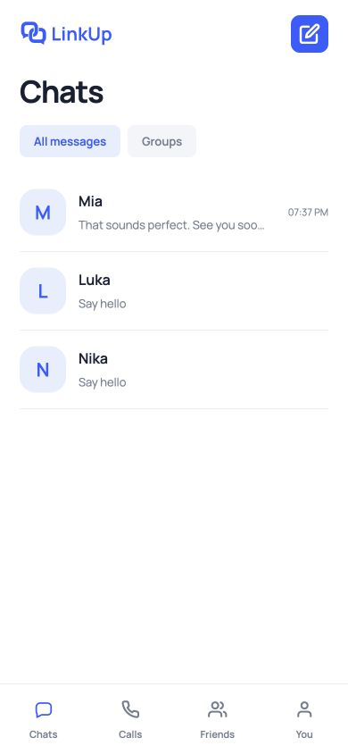
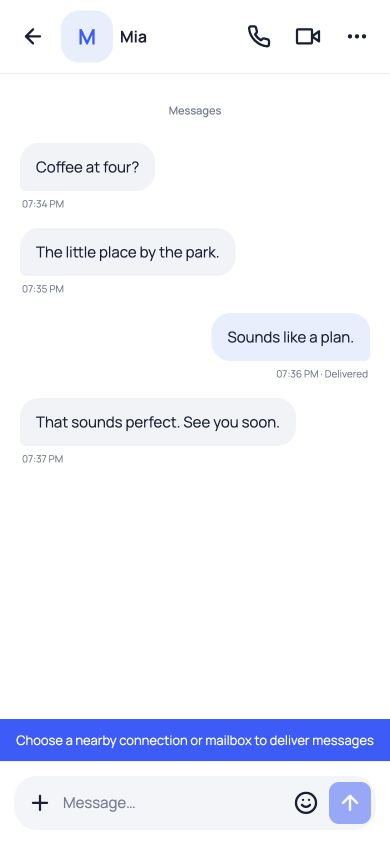
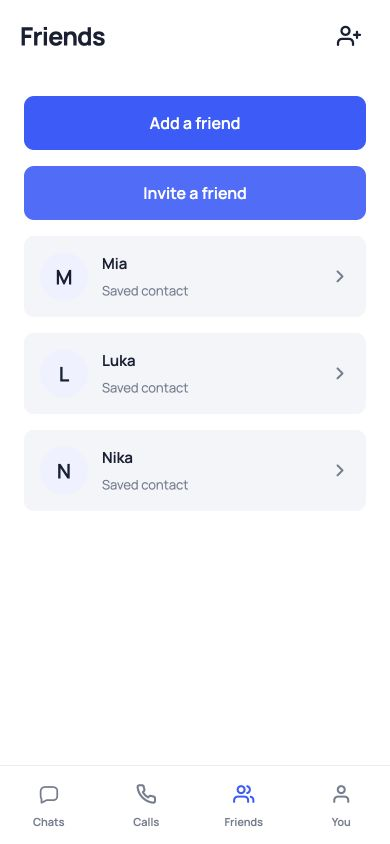
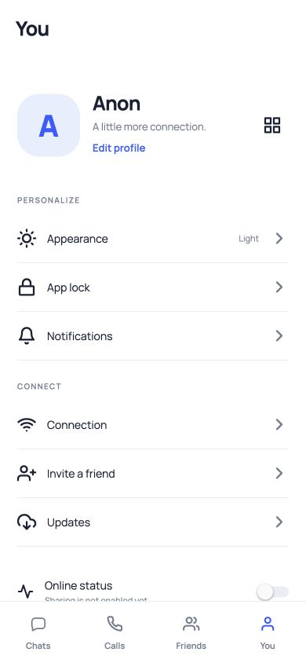
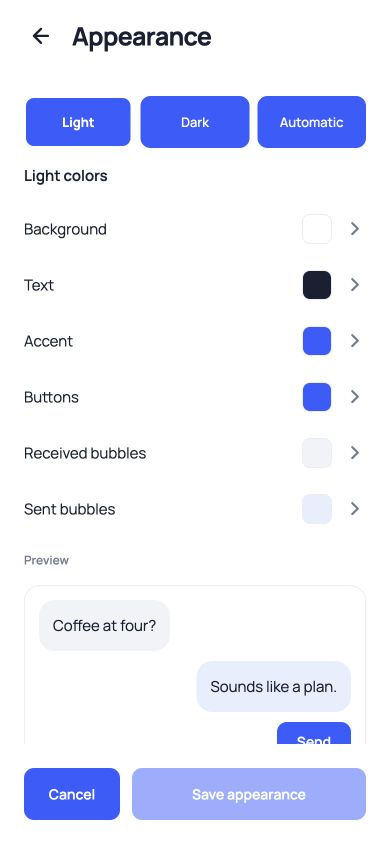
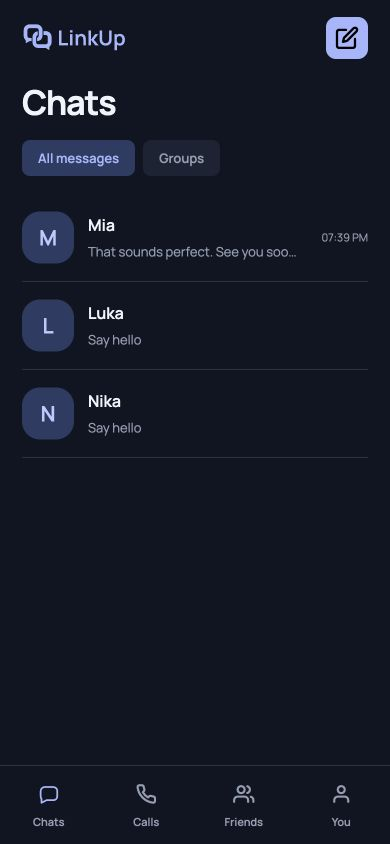

# LinkUp

Chat, call, and connect with friends.

**[Download for Android](https://github.com/KTihana/LinkUp/releases/latest)**

## Screenshots

App screens with sample conversations.

<table>
<tr><td></td><td></td><td></td></tr>
<tr><td></td><td></td><td></td></tr>
</table>

[Build instructions](app/BUILD.md) · [Server setup](deploy/README.md) · [Publishing updates](app/UPDATES.md)

GPL-3.0-only. Required dependency licenses are included with the source.
