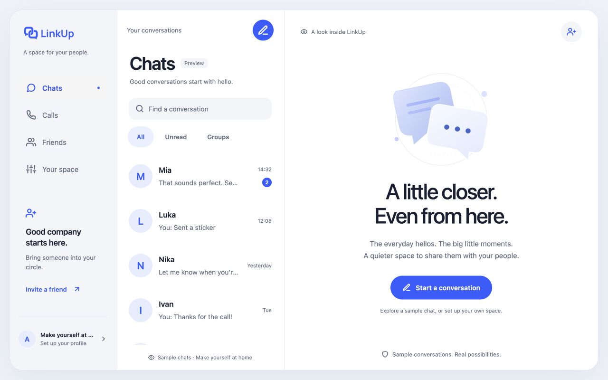
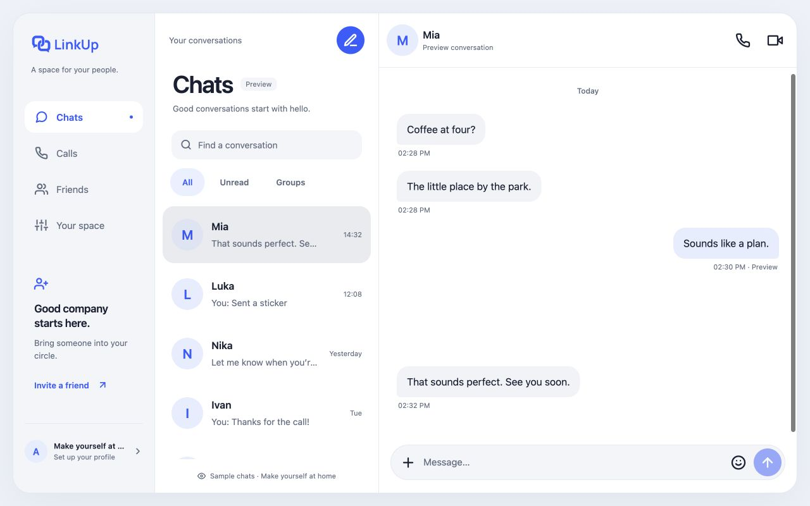
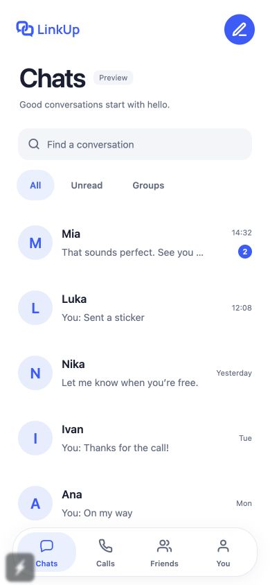
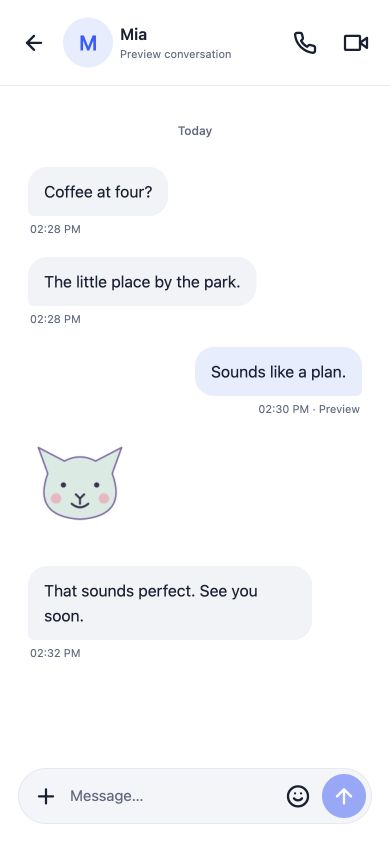
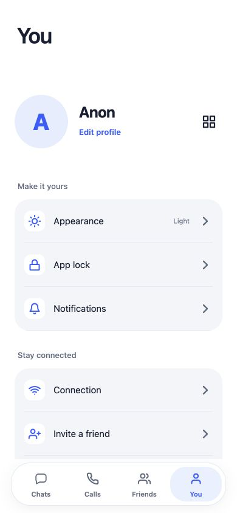
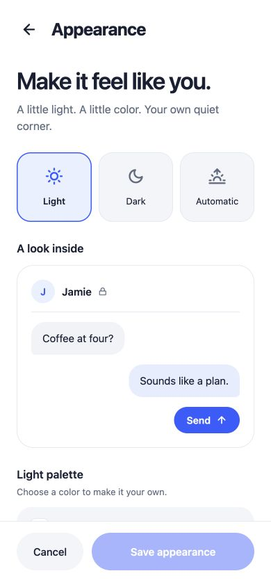
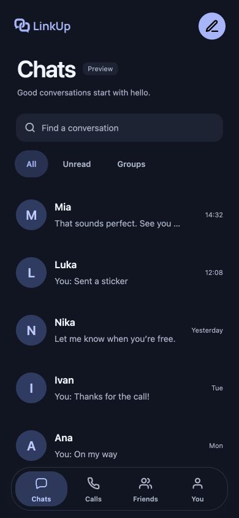

  

Chat, call, and connect with friends.

  
  &nbsp;
  

<strong>Android 7+ · ARM64</strong> Install updates over your existing app to keep your chats.

## A look at LinkUp

The app’s desktop web and mobile layouts, shown in a responsive browser with sample conversations.

### Desktop web

<table>
  <tr>
    <th>Chats</th>
    <th>Conversation</th>
  </tr>
  <tr>
    <td></td>
    <td></td>
  </tr>
</table>

### Mobile layouts

<table>
  <tr>
    <th>Chats</th>
    <th>Conversation</th>
    <th>Profile</th>
  </tr>
  <tr>
    <td></td>
    <td></td>
    <td></td>
  </tr>
</table>
<table>
  <tr>
    <th>Appearance</th>
    <th>Dark mode</th>
  </tr>
  <tr>
    <td></td>
    <td></td>
  </tr>
</table>

## Build and run

[App build instructions](app/BUILD.md) · [Server setup](deploy/README.md) · [Publishing updates](app/UPDATES.md)

GPL-3.0-only. Required dependency licenses are included with the source.
